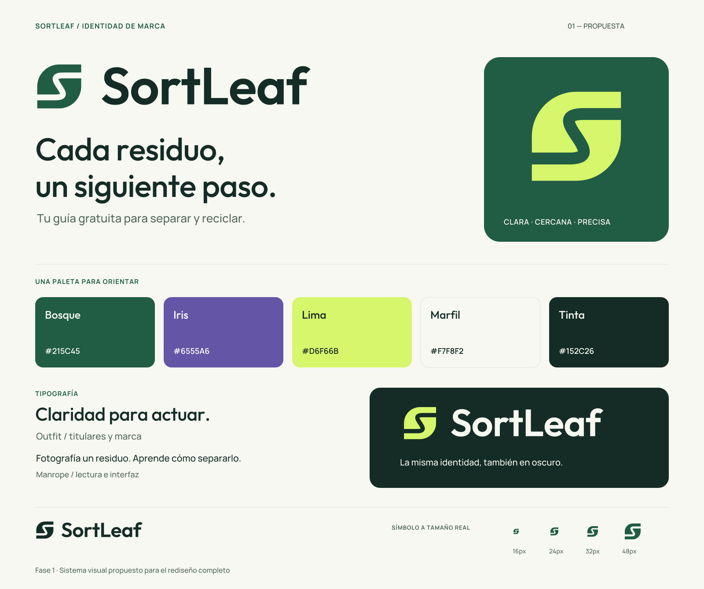

# SortLeaf — Identidad de marca

Fase 1 · Propuesta v1 · 8 de noviembre de 2026 · Pendiente de aprobación visual.

## 1. Concepto y personalidad

**Idea central: hacer comprensible el siguiente paso de cada residuo.** SortLeaf es una herramienta gratuita que orienta a personas sobre separación y reciclaje. El punto de partida es la experiencia de reciclaje de SortLeaf: clasificación de imágenes, consulta por código de barras, asistente y mapa de puntos de reciclaje.

La marca une *sort* (clasificar) con *leaf* (hoja). La identidad traduce esa unión en una hoja geométrica con dos partes, separadas por un recorrido en forma de S. La separación visual representa ordenar; el recorrido representa orientación.

**Personalidad:** clara, cercana y precisa.

- **Clara:** una acción comprensible y una explicación útil en cada momento.
- **Cercana:** lenguaje cotidiano, amable y sin culpabilizar a quien está aprendiendo.
- **Precisa:** distingue lo que se conoce de lo que se estima. No implica que el modelo acierte siempre.

**Promesa:** ayudarte a reconocer un residuo y comprender cómo separarlo, con orientación gratuita y fácil de usar.

**Tagline:** «Cada residuo, un siguiente paso.»

**Descriptor:** «Tu guía gratuita para separar y reciclar.»

**Nombre escrito:** SortLeaf, con S y L mayúsculas. En comunicación corriente no usar SORTLEAF, Sort Leaf ni Sortleaf. La forma en mayúsculas puede utilizarse en índices de esta guía o etiquetas editoriales, no como sustituto del logotipo.

Se mantiene el uso gratuito. Esta identidad prepara un rediseño completo; no añade una oferta empresarial, precios ni nuevas funciones al producto. La comunicación principal será en español para Costa Rica, conservando la posibilidad de inglés y expansión regional. Las instrucciones de reciclaje deben contextualizarse por material y destino; el nombre no presupone cobertura completa de puntos de entrega.

## 2. Sistema de logo

El símbolo se dibujó específicamente para SortLeaf. No procede de una biblioteca de iconos. Su silueta de hoja se construye sobre una retícula de 32 unidades; un canal transparente de 3,2 unidades forma la S. La tipografía del nombre utiliza Outfit 600 con espaciado óptico y se entrega convertida a contornos: los SVG no necesitan fuentes instaladas.

| Archivo | Aplicación |
| --- | --- |
| [sortleaf-horizontal.svg](logos/sortleaf-horizontal.svg) | Marca principal, bosque y tinta, fondo transparente. |
| [sortleaf-icon.svg](logos/sortleaf-icon.svg) | Símbolo independiente en bosque. |
| [sortleaf-monochrome.svg](logos/sortleaf-monochrome.svg) | Marca completa en una sola tinta oscura. |
| [sortleaf-monochrome-white.svg](logos/sortleaf-monochrome-white.svg) | Marca completa en blanco, fondo transparente. |
| [sortleaf-reversed.svg](logos/sortleaf-reversed.svg) | Marca lima y marfil, fondo transparente, para superficies oscuras. |
| [sortleaf-on-dark.svg](logos/sortleaf-on-dark.svg) | Ejemplo con fondo tinta incluido. |
| [sortleaf-icon-monochrome.svg](logos/sortleaf-icon-monochrome.svg) | Símbolo oscuro para reproducción de una tinta. |
| [sortleaf-icon-reversed.svg](logos/sortleaf-icon-reversed.svg) | Símbolo lima para fondos oscuros. |
| [favicon.svg](logos/favicon.svg) | Favicon con fondo bosque, usable en pestañas claras y oscuras. |

Hay derivados PNG de favicon a 16, 32, 48, 192 y 512px; ICO de 16/32/48px; e icono de inicio Apple de 180px. El icono Apple no incorpora esquinas transparentes: el sistema operativo aplica su máscara.

### Tamaños y espacio de seguridad

- **Símbolo:** mínimo 16 × 16px en pantalla. El SVG conserva una silueta visible de 12px dentro de ese lienzo; el canal mide 1,6px a ese tamaño. En botones, usar preferiblemente 24px y mantener un área táctil mínima de 44px.
- **Marca horizontal:** ancho mínimo recomendado 132px. Por debajo, usar el símbolo y mantener el nombre accesible en el contexto.
- **Espacio libre:** definir `x = H/4`, donde H es la altura visible del símbolo. Mantener al menos x entre cualquier borde visible de la marca y otros elementos. Ejemplo: símbolo visible de 48px → 12px libres. Este espacio se añade mediante el diseño; el margen interno del archivo no siempre lo proporciona por completo.
- Conservar la proporción original. Dimensionar con una sola medida y `height: auto` cuando corresponda.
- El favicon es una aplicación específica dentro de un recuadro; su margen compacto es una excepción al espacio de seguridad de la marca horizontal.

### Uso correcto

- Horizontal bosque/tinta sobre blanco o marfil.
- Inverso lima/marfil sobre tinta o bosque.
- Una sola tinta en documentos monocromáticos.
- Sobre fotografía, añadir una superficie opaca que respete el espacio de seguridad.
- En HTML, usar `alt="SortLeaf"`; si el nombre ya está expresado junto al símbolo, este puede ser decorativo. Si el logo enlaza al inicio, darle un nombre accesible como «SortLeaf, inicio».
- Al insertar varios SVG directamente en el mismo documento, generar IDs únicos para títulos y máscaras. Referenciarlos con `` mantiene cada SVG aislado.

### Uso incorrecto

- Estirar, inclinar, rotar, cambiar el canal o separar las dos partes del símbolo.
- Recrear el nombre con otra fuente, cambiar la relación entre símbolo y nombre o añadir «AI» al logo.
- Aplicar degradados, contornos, biseles, brillos o sombras a la marca.
- Usar la versión lima/blanca sobre fondos claros.
- Meter texto, imágenes o botones dentro de su espacio de seguridad.
- Usar el símbolo como indicador de certificación ambiental o como garantía de reciclabilidad.

## 3. Paleta y contraste

| Rol | Color | HEX | Decisión |
| --- | --- | --- | --- |
| Primario | Bosque | `#215C45` | Relaciona la marca con el ambiente y aporta contraste para acciones. |
| Secundario | Iris | `#6555A6` | Distingue ayuda y estados de interacción sin depender de otro verde. |
| Acento | Lima | `#D6F66B` | Aporta energía en detalles y superficies puntuales. Lleva texto tinta. |
| Fondo | Marfil | `#F7F8F2` | Superficie cálida y serena para lectura y contenido. |
| Texto | Tinta | `#152C26` | Texto principal y base de aplicaciones oscuras. |
| Superficie | Blanco | `#FFFFFF` | Paneles y texto inverso. |
| Texto secundario | Musgo | `#52665D` | Descripciones y metadatos de lectura habitual. |
| Éxito | Verde | `#236846` | Sobre fondo `#EAF4EC`, junto con texto que explique el resultado. |
| Error | Arcilla | `#B6383C` | Sobre fondo `#FCECEE`, con indicación de cómo corregir el problema. |
| Información | Azul | `#4B5FAD` | Sobre fondo `#EEF0FA`, para información neutral. |

La composición será predominantemente marfil y blanca, con tipografía tinta. Bosque organiza las acciones; lima e iris se emplean con moderación. No convertir todas las secciones en bloques verdes.

La revisión numérica incluye 62 pares funcionales de los temas claro y oscuro. Todos los pares de texto definidos superan 4,5:1; los de bordes y foco superan 3:1. Ejemplos: blanco/bosque 7,83:1; iris/marfil 5,78:1; tinta/lima 12,15:1. [Informe y metodología](CONTRAST.md).

**Regla esencial:** blanco sobre lima no pasa; se utiliza tinta. Lima sobre marfil tampoco se utiliza como texto. Los colores de la marca no asignan colores a contenedores de reciclaje: esas indicaciones dependen del sistema local y deben llevar nombre o símbolo.

El tema oscuro usa superficies específicas y colores de texto ajustados, definidos en `tokens.css`. No es una inversión automática. Esta revisión de paleta no equivale a una auditoría WCAG de la futura web.

## 4. Tipografía

**Outfit** para titulares y marca: geometría amable y formas abiertas que acompañan al símbolo. Titulares 500/600; logotipo 600.

**Manrope** para cuerpo, navegación, controles y datos: lectura estable, buen detalle en tamaños pequeños y continuidad visual con Outfit. Cuerpo 400; etiquetas 500/600; énfasis 700.

Ambas familias utilizan OFL-1.1, permiten uso comercial gratuito y se entregan localmente. Se verificaron los caracteres españoles. El CSS de fuentes usa `font-display: swap`; no necesita peticiones a Google. [Procedencia, licencias y hashes](fonts/README.md).

| Nivel | Tamaño objetivo | Interlineado | Peso | Familia |
| --- | --- | --- | --- | --- |
| Display | 40–64px, fluido | 1,08 | 500/600 | Outfit |
| H1 / título grande | 32–48px, fluido | 1,2 | 500/600 | Outfit |
| H2 | 32px | 1,2 | 500/600 | Outfit |
| H3 | 24px | 1,2 | 500/600 | Outfit |
| Introducción | 18px | 1,65 | 400/500 | Manrope |
| Cuerpo / controles | 16px | 1,65 / 1,4 | 400 / 600 | Manrope |
| Texto secundario | 14px | 1,65 | 400/500 | Manrope |
| Metadatos no esenciales | 12px | 1,4 | 500 | Manrope |

Los valores se implementan con `rem`; el tamaño se adapta a las preferencias del usuario. No usar 12px para errores, ayuda necesaria o instrucciones. Evitar párrafos largos en mayúsculas y limitar la longitud de lectura a unos 68 caracteres.

## 5. Tokens y reglas de composición

Archivo preparado: [tokens.css](tokens.css). Prefijo `--sl-`; colores primitivos separados de roles semánticos; tema oscuro mediante `data-sl-theme="dark"`.

- **Espaciado:** unidad de 4px; escala 4, 8, 12, 16, 20, 24, 32, 40, 48, 64, 80 y 96px.
- **Radios:** 8px controles compactos; 12px controles/paneles; 20px tarjetas; 28px bloques destacados; píldora cuando la forma tenga sentido.
- **Sombras:** discretas, de 5–12% de tinta en claro; destinadas a jerarquía, no a decorar todas las superficies.
- **Ancho:** contenedor de 1200px; márgenes laterales fluidos; contenido de lectura de 68ch.
- **Responsive:** base desde 360px; cambios por contenido en 480, 768, 1024 y 1440px. Las variables de breakpoint documentan los valores; en `@media` nativo se escriben los valores literales.
- **Interacción:** objetivo táctil mínimo de 44px; foco de 3px con separación de 3px.
- **Movimiento:** 120ms para respuesta inmediata, 180ms para estados, 280ms para transiciones de contenido. Sin movimiento imprescindible para entender el resultado. Respetar `prefers-reduced-motion` con los tokens de duración y distancia.

La futura interfaz utilizará superficies amplias, jerarquía tipográfica y pocas acciones competidoras. Los detalles botánicos proceden del símbolo; no se necesitan hojas decorativas en cada componente.

## 6. Iconos e imágenes

**Iconografía propuesta:** Lucide, retícula de 24px, trazo 2px, extremos redondeados, tamaños habituales 20/24px. Utilizar una sola familia. Cámara, código de barras, mapa y mensaje representarán las funciones existentes. El logotipo no se sustituye por el icono de hoja de la biblioteca.

Lucide utiliza ISC, con avisos MIT adicionales para los iconos heredados de Feather. Se conserva la licencia completa; no exige atribución visible. En esta fase no se incorporaron iconos de la librería a la aplicación.

**Fotografía:** materiales cotidianos claramente reconocibles, luz difusa, fondos marfil o neutros, encuadres limpios, color natural y textura visible. Priorizar papel, cartón, envases sin marcas y objetos aislados. Mostrar contextos reales de clasificación cuando sean útiles.

**Ilustración:** formas sencillas derivadas de la geometría del símbolo, volumen mínimo y paleta limitada. La decoración no debe confundirse con un resultado real del clasificador.

**Evitar:** marcas visibles, rostros usados como aval, bosques genéricos que no expliquen el producto, hojas sobre cada objeto, fotografías excesivamente saturadas, imágenes de residuos peligrosos presentadas como categorías soportadas y cifras ambientales sin evidencia.

Los recursos fotográficos se seleccionarán y licenciarán individualmente en la Fase 3. Esta identidad no contiene fotografías externas. El alt text describirá el objeto y el contexto relevante; las imágenes puramente decorativas llevarán alt vacío.

## 7. Voz y mensajes de marca

Hablar de tú, con verbos concretos y frases breves: identificar, separar, consultar y encontrar. Enseñar sin regañar; explicar sin tecnicismos innecesarios. El español se mantiene natural para Costa Rica y comprensible en LATAM.

Ejemplos de tono, no un inventario de copy final de la página:

- Acción: «Identificar un residuo».
- Ayuda: «Procura que el objeto se vea completo y tenga buena luz».
- Incertidumbre: «No pudimos identificarlo con suficiente claridad. Prueba con otra foto».
- Contexto: «Confirma qué materiales acepta el punto de entrega antes de ir».

Evitar garantías de exactitud, cifras de ahorro sin medición, impacto certificado y cobertura completa del mapa. Las estadísticas actuales se presentarán como estimaciones cuando corresponda.

## 8. Cierre de Fase 1

Preparados: concepto, personalidad, promesa, tagline, SVG originales y variantes, favicon, paleta con verificación de contraste, dos familias OFL, escala tipográfica, tokens y reglas de uso.

Se revisaron las láminas renderizadas y el símbolo a tamaños reales. La aplicación actual no importa estos recursos todavía. Queda pendiente la aprobación de esta dirección visual; después corresponde la Fase 2, estrategia y contenido, seguida de recursos y desarrollo.
